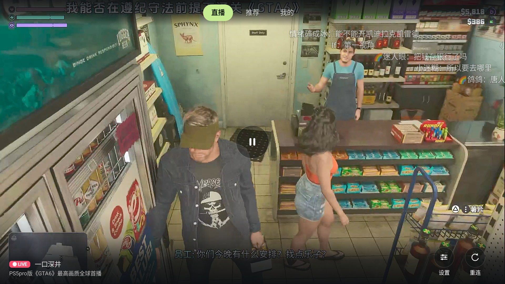
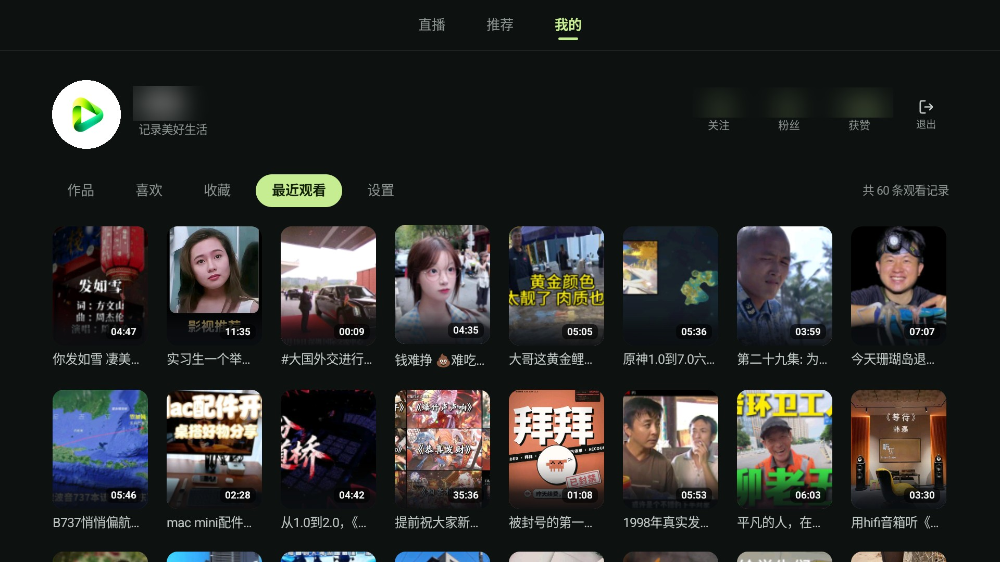
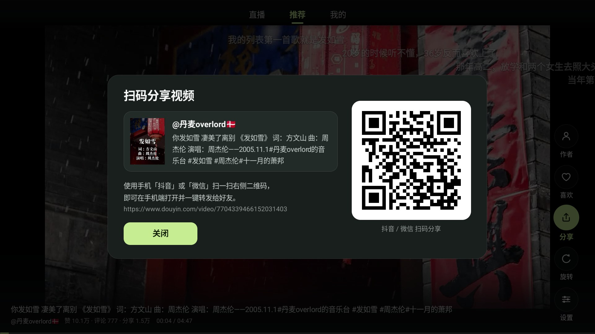

<div align="center">


# 抖音TV

**用遥控器大屏刷抖音、看直播，沉浸式电视与投影仪体验。**

抖音第三方 **Android 电视 / 投影仪客户端**

[](https://github.com/Amor5207/douyin-tv/releases/latest)
[](#系统要求与安装)
[](https://github.com/Amor5207/douyin-tv/releases/latest)
[](LICENSE)

[下载 1.0.0](https://github.com/Amor5207/douyin-tv/releases/latest) · [界面预览](#界面预览) · [功能特性](#功能特性) · [构建项目](#构建项目)

<br>


</div>

## 简介

**抖音TV 1.0.0** 是面向智能电视、投影仪与 Android TV 盒子的抖音第三方原生客户端：

- **纯原生大屏设计**：基于 1920×1080 大屏与遥控器方向键交互打造，无多余广告与复杂层级，打开即看推荐流与直播。
- **全架构通用单包**：纯 Java 实现，不含平台原生 `.so` 库，单个安装包通用 **ARMv7（32 位）/ ARM64（64 位）/ x86 / x86_64** 架构，最低兼容 **Android 6.0（API 23）**。
- **高清流畅播放**：内置 Media3 ExoPlayer 硬件解码，支持 1080P 高码率直链播放、双槽后台首帧预热与边播边缓，切视频零黑屏、无感起播。

---

## 界面预览

<table>
  <tr>
    <td width="50%"></td>
    <td width="50%"></td>
  </tr>
  <tr>
    <td align="center"><sub>推荐流大屏播放与磨砂浮层控制</sub></td>
    <td align="center"><sub>直播流播放与实时弹幕</sub></td>
  </tr>
  <tr>
    <td width="50%"></td>
    <td width="50%"></td>
  </tr>
  <tr>
    <td align="center"><sub>个人主页（作品 / 喜欢 / 收藏 / 最近观看 / 设置）</sub></td>
    <td align="center"><sub>本地生成二维码一键扫码分享</sub></td>
  </tr>
</table>

---

## 功能特性

- **遥控器原生大屏交互**：顶部「直播 / 推荐 / 我的」胶囊导航栏默认聚焦居中「推荐」，无操作自动隐藏进入全屏播放；播放中按返回键直达顶部导航，左右键呼出控制层，上下键切视频/切直播间。
- **高清推荐流与无感切集**：采用 Media3 ExoPlayer 硬件解码与 1080P 高码率优先选流策略，配合后台首帧预热与本地边播边缓，上下切换秒开不黑屏；支持点赞/取消点赞、倍速、画面旋转、自动连播与作者主页浏览。
- **实时直播与智能兜底**：启动时后台预载直播列表，支持 FLV / HLS 协议交替兜底与首帧/断流自动超时跳过，避免死链长时间转圈；内置实时直播弹幕与清晰度/协议切换。
- **真实评论弹幕**：视频弹幕来源于作品真实评论，支持自由开关及滚动速度、字号、不透明度自定义。
- **扫码登录与安全验证**：支持抖音 App 扫码登录、二维码自动续期，并在触发短信安全验证时提供原生数字键盘内联验证码输入体验。
- **个人中心与云端同步**：登录态下同步查看「作品 / 喜欢 / 收藏 / 最近观看」，支持历史记录自动续播与手机局域网投送链接。
- **扫码分享视频**：播放页一键生成当前视频的抖音官方链接二维码，使用手机抖音或微信扫一扫即可快速转发给好友。
- **应用内自更新**：内置版本检测、SHA-256 校验与系统安装器唤起流程，后续新版本可在「我的 → 设置」中一键升级。

---

## 版本信息

| 项目 | 数值 |
| --- | --- |
| 当前版本 | `1.0.0` |
| 内部版本号 | `1000` |
| Android 包名 | `ink.pengfei.douyin` |

---

## 系统要求与安装

| 项目 | 要求 |
| --- | --- |
| 系统版本 | Android 6.0（API 23）及以上 |
| 适用设备 | 智能电视、投影仪、Android TV 盒子 |
| 解码能力 | 支持 H.264 / H.265 硬件解码 |
| 架构兼容 | 纯 Java 实现，32 位 / 64 位 ARM 与 x86 全架构通用 |

1. 从 [Releases](https://github.com/Amor5207/douyin-tv/releases/latest) 下载 `DouyinTV-1.0.0.apk`。
2. 通过 U 盘、局域网传输或 ADB 安装到电视或投影仪。
3. 打开应用后使用手机抖音 App 扫码登录即可开始刷视频、看直播。

---

## 构建项目

无需 Gradle，直接使用 Android SDK 工具链（JDK 17+、Android SDK Platform 35 与 Build-Tools 35.0.0）即可独立构建：

```shell
sh build.sh
```

如需自定义版本号或签名密钥，可通过环境变量覆盖：

```shell
DOUYIN_VERSION_NAME=1.0.0 DOUYIN_VERSION_CODE=1000 sh build.sh
```

首次构建时若 `libs/media3/jars` 不存在，脚本会自动运行 `tools/FetchMedia3.java` 拉取 Media3 1.5.1 依赖并预编译 DEX。

---

## 项目结构

| 目录 | 说明 |
| --- | --- |
| `src/ink/pengfei/douyin/` | 应用入口、主界面、扫码登录、作者主页、全屏播放与中转页面 |
| `src/ink/pengfei/douyin/net/` | 抖音接口请求、登录态管理、请求签名与直播弹幕客户端 |
| `src/ink/pengfei/douyin/model/` | 视频、直播间、用户与评论数据模型及清晰度选流策略 |
| `src/ink/pengfei/douyin/ui/` | Android TV 大屏原生播放页、弹幕层、个人中心与弹窗组件 |
| `src/ink/pengfei/douyin/update/` | 应用内自更新检查、下载、SHA-256 校验与安装流程 |
| `src/ink/pengfei/douyin/util/` | 本地缓存、图片与二维码生成、主题与偏好存储 |
| `tools/` | Media3 依赖自动拉取脚本（`FetchMedia3.java`） |

---

## 使用声明

本项目仅供个人学习与研究使用，与抖音及其关联公司无关，未获其任何授权或背书。项目本身不提供、不存储、不分发任何视频或直播内容，所有媒体资源与内容版权归原权利人所有。登录凭证仅保存在使用者本地设备，可随时退出或清除。

## 开源协议

本项目采用 [GNU General Public License v3.0](LICENSE) 开源协议。
